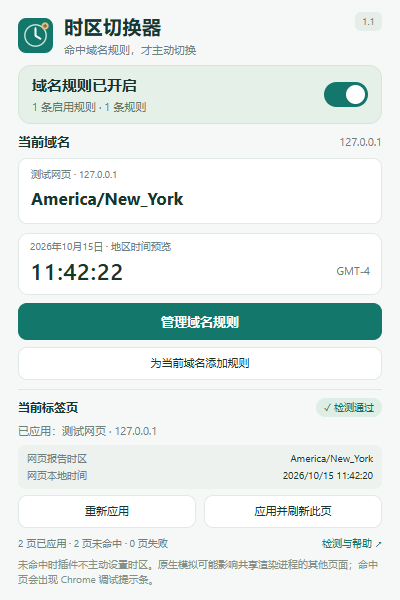
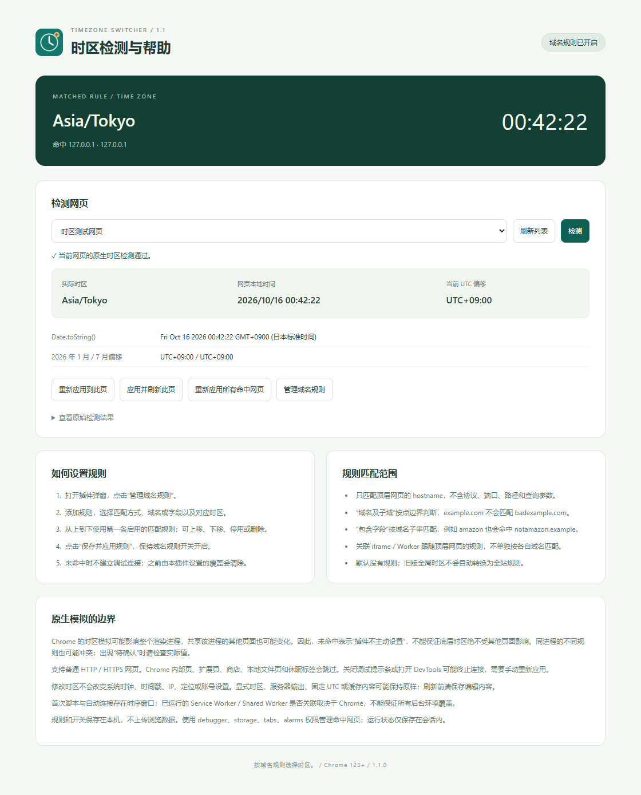
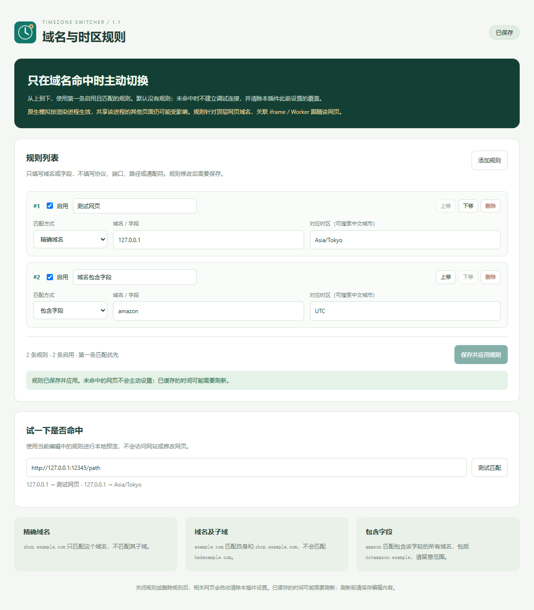

<p align="center">
  
</p>

<h1 align="center">Time Zone Convertor</h1>

<p align="center">时区切换器：域名命中规则时，才主动切换。</p>

<p align="center">
  
  
  <a href="LICENSE"></a>
</p>

一个无需构建、无需账号、无需服务端的 Chrome 扩展。通过域名规则为网页选择对应时区，支持精确域名、域名及子域、包含字段匹配，以及夏令时、关闭恢复、重启恢复与实际生效检测。

A lightweight Chrome extension that applies IANA time zones to matching domains using Chrome's native timezone emulation. Rules are ordered; the first enabled match wins. Unmatched tabs are not actively overridden.

> **使用前须知：**启用时 Chrome 会显示调试提示条。关闭提示条或打开 DevTools 可能终止相关连接，之后需要点击“重新应用”。插件修改网页使用的时区，不修改系统时钟、IP 或地理位置。

> **隔离限制：**Chrome 原生时区覆盖可能影响整个渲染进程。未命中表示插件不主动连接或设置，无法保证同进程的其他页面完全不受影响；同进程的不同规则也可能冲突。规则按顶层网页域名判断，关联 iframe / Worker 跟随该网页。

[安装](#安装) · [使用](#使用) · [检测与排查](#检测与排查) · [支持范围](#支持范围) · [开发与测试](#开发与测试) · [版本变化](CHANGELOG.md)

## 界面预览

<p align="center">
  
</p>

<details>
<summary>查看详细检测界面</summary>



</details>

截图来自真实测试环境；日期、时钟和标签页数量仅为示例。



## 功能

- **域名规则**：精确域名、域名及子域或包含字段；每条规则选择自己的 IANA 时区。
- **规则优先级**：从上到下取第一条启用的匹配规则，可排序、停用、删除，并在保存前本地预览是否命中。
- **未命中不主动设置**：不建立调试连接；如果网页曾命中，清除本插件先前设置的覆盖。没有全局兜底时区。
- **自动应用**：对命中网页处理新标签、导航和重启；每分钟核对可能遗漏的标签。
- **原生日期规则**：通过 Chrome 原生模拟处理 `Date`、`Intl` 的默认时区，按地区规则处理夏令时和非整点偏移。
- **关闭恢复**：关闭插件内开关后，先清除覆盖，再断开调试连接。
- **设置持久化**：在本机保存开关和目标时区，重启后继续使用。
- **生效检测**：从当前网页读取实际时区、本地时间、UTC 偏移及冬夏偏移，显示暂停、失败和子目标警告。

## 安装

要求 **桌面版 Chrome 125 或以上版本**。日常使用无需安装 Node.js，也无需执行构建命令。

### 1. 获取源码

可以[下载源码 ZIP](https://github.com/NeverBetterEnough/time-zone-convertor/archive/refs/heads/main.zip) 并完整解压，或使用 Git：

```bash
git clone https://github.com/NeverBetterEnough/time-zone-convertor.git
```

### 2. 加载到 Chrome

1. 在 Chrome 地址栏打开 `chrome://extensions`。
2. 打开页面右上角的“开发者模式”。
3. 点击“加载已解压的扩展程序”。
4. 选择**直接包含 `manifest.json` 的目录**，例如克隆后的 `time-zone-convertor` 文件夹。
5. 点击工具栏拼图图标，将“时区切换器”固定到工具栏。

加载后**规则开关默认开启，规则列表为空**，不会主动修改任何网页。先按下方说明添加并保存规则。

**从 v1.0 升级：**原有全局时区不会自动变成全站规则。请重新加载扩展后打开规则页，添加所需域名；旧的全局设置停止使用。

保留加载时使用的目录；不要直接选择 ZIP 文件或仓库的父目录。移动目录后，需要重新加载扩展。

[v1.0 PDF 教程](时区切换器-使用教程.pdf) 保留作旧版与安装参考，其中的全局时区操作不适用于 v1.1；当前规则设置请以本 README 和规则页说明为准。PDF 中的本机路径请替换为实际目录。

## 使用

### 添加域名规则

1. 打开一个普通 HTTP / HTTPS 网页，点击插件图标。
2. 点击“管理域名规则”；也可点击“为当前域名添加规则”预填域名。
3. 添加规则，填写匹配方式、域名或字段、对应时区；按需上移、下移或停用。
4. 点击“保存并应用规则”，保持“域名规则”开关开启。
5. 回到网页，在弹窗查看命中的规则和实际时区。

| 匹配方式 | 示例字段 | 会命中 | 不会命中 |
| --- | --- | --- | --- |
| 精确域名 | `shop.example.com` | `shop.example.com` | `a.shop.example.com` |
| 域名及子域 | `example.com` | `example.com`、`shop.example.com` | `badexample.com`、`example.com.evil.test` |
| 包含字段 | `amazon` | `www.amazon.com`、`notamazon.example` | 仅在路径或参数中出现 amazon 的其他域名 |

只检查顶层网页的 `hostname`，忽略协议、端口、路径、查询参数和大小写。域名末尾的点会移除，精确/子域规则中的国际化域名会规范化；“包含字段”使用英文字母、数字、点、短横线或下划线，不接受通配符和正则表达式。

**优先级按列表顺序，不按匹配方式。**例如精确规则和包含规则同时命中时，使用排在前面的启用规则。最多保存 200 条规则，停用规则不参与匹配。

例：将“域名及子域 / example.com”设为 `America/New_York`，将“包含字段 / amazon”设为 `Asia/Tokyo`。未命中的网页不主动设置时区；从命中域名导航至未命中域名，或删除/停用最后一条匹配规则时，会清除本插件此前设置的覆盖。

| 地区 | 时区标识 | 规则示例 |
| --- | --- | --- |
| 上海 / 北京 | `Asia/Shanghai` | UTC+08:00 |
| 东京 | `Asia/Tokyo` | UTC+09:00 |
| 纽约 | `America/New_York` | 冬季 UTC-05:00，夏季 UTC-04:00 |
| 伦敦 | `Europe/London` | 冬季 UTC+00:00，夏季 UTC+01:00 |
| 加德满都 | `Asia/Kathmandu` | UTC+05:45 |
| 协调世界时 | `UTC` | UTC+00:00 |

浏览器可能将部分标识规范化为别名，这是正常行为。地区规则由 Chrome 内置的时区数据库处理。

### 各个按钮的作用

| 操作 | 行为 |
| --- | --- |
| 域名规则开关 | 开启按规则应用；关闭后清除本插件设置 |
| 管理域名规则 | 添加、排序、停用、删除和测试规则 |
| 为当前域名添加规则 | 打开规则页并预填当前域名；保存后生效 |
| 保存并应用规则 | 原子校验并保存整个规则列表，核对现有网页 |
| 重新应用 | 手动恢复当前标签的连接并重新设置时区 |
| 应用并刷新此页 | 命中时应用后刷新；未命中或关闭状态下只刷新 |
| 检测与帮助 | 打开详细检测页，选择网页并查看原生日期接口的实际结果 |

**刷新前请保存网页中的编辑内容。**网页可能缓存旧的时间字符串或格式化器，插件不会自动刷新所有标签。

上方地区时钟只是预览；判断是否生效，应查看“网页报告时区”与检测结果。

## 检测与排查

点击“检测与帮助”，选择需要检测的网页，再点击“检测”。

| 状态 | 含义 | 建议操作 |
| --- | --- | --- |
| 检测通过 | 网页报告的时区与设置一致 | 继续使用；页面内容仍旧时可刷新 |
| 待确认 | 已应用但尚未确认实际值一致 | 等待页面加载后再检测，或重新应用 |
| 已暂停 | 用户取消调试，或 DevTools 等导致连接终止 | 关闭 DevTools，再点击重新应用 |
| 应用失败 | 连接受限或与其他调试工具冲突 | 关闭冲突工具后重试，检查浏览器策略 |
| 不支持 | 当前页面不能处理 | 切换到普通 HTTP / HTTPS 网页 |
| 已关闭 | 插件内开关关闭 | 按需重新开启 |
| 未命中 | 没有启用的匹配规则，未主动连接 | 按需添加规则；无需改动时保持原样 |

### 常见问题

**为什么出现“正在调试此浏览器”的提示？** 这是 `chrome.debugger` 的浏览器提示。插件通过该接口使用 Chrome 原生时区模拟；关闭提示条会终止相关连接。

**关闭提示条后为什么不自动恢复？** 插件尊重主动取消，不会反复抢回暂停的标签。点击“重新应用”恢复当前命中页；保存规则或在检测页点击“重新应用所有命中网页”可批量恢复。

**未命中，为什么时间也发生了变化？** 本插件不会主动给该标签设置时区，但 Chrome 的原生模拟是进程级的。若与命中网页共用渲染进程，仍可能受影响。本版本保留原生模拟能力，不承诺严格的页面隔离。

**检测通过，但网站显示的时间仍未变化？** 网站可能按账号设置、服务器规则、固定 UTC 或显式指定时区显示时间，也可能缓存了旧值。先保存编辑内容，再刷新确认。

**如何恢复或卸载？** 建议先关闭插件内开关，确认恢复，再到扩展管理页停用或移除。强制停用或卸载时后台没有清理机会；若页面仍显示旧时间，请刷新或重新打开标签。

## 支持范围

本项目使用 **`chrome.debugger` + `Emulation.setTimezoneOverride`**，按标签和相关调试目标应用时区；Chrome 没有向普通扩展提供全浏览器统一修改时区的设置接口。

- **支持**普通 `http://`、`https://` 网页。
- **跳过** Chrome 内部页、扩展页、Chrome 网上应用店、`file://` 页面和休眠标签；休眠标签唤醒后重新检查。
- 跨进程 iframe 会递归连接。对关联 Worker 尝试原生覆盖；命令不可用时检查继承的时区，不一致时显示警告。
- 已运行的 Service Worker / Shared Worker 能否关联取决于 Chrome 的目标关系，**不保证所有后台环境都覆盖**。
- 自动连接与页面启动之间存在时序窗口，**无法保证早于首次访问的所有网页脚本**。
- 独立渲染的不同站点可以按规则使用不同时区。**共享渲染进程的页面可能相互影响或发生规则冲突**；检测值不一致时会显示“待确认”，不能保证未命中页面完全不受连带影响。
- 不修改 Windows / macOS / Linux 系统时区、系统时钟、时间戳、IP、定位、浏览器语言或网站账号设置。
- 无痕窗口默认不运行。本版本未对无痕模式或其他 Chromium 浏览器作兼容性承诺。
- 企业浏览器策略、DevTools、其他调试扩展或时区工具可能限制连接或导致冲突。

## 权限与隐私

| 权限 | 用途 |
| --- | --- |
| `debugger` | 设置原生时区模拟，读取检测值，管理相关 iframe / Worker |
| `storage` | 本机保存设置，在浏览器会话内保存连接与暂停状态 |
| `tabs` | 识别普通网页、监听标签与导航、在检测页列出标签 |
| `alarms` | 每分钟核对遗漏的标签；关闭且清理完成后移除闹钟 |

扩展运行时代码没有服务器请求、遥测或第三方 CDN，不上传浏览数据。持久存储仅包含开关与域名规则；运行状态保存在 `storage.session`。检测页的网页标题仅用于本地选择标签。

## 开发与测试

要求 Node.js 20+。测试依赖通过 npm 安装，扩展本身无需构建。

```bash
git clone https://github.com/NeverBetterEnough/time-zone-convertor.git
cd time-zone-convertor
npm ci
npm test
```

### 真实浏览器测试

```bash
npx playwright install chromium
npm run test:e2e
```

也可以通过 `CHROMIUM_PATH` 指定 Chromium / Chrome for Testing 的可执行文件。PowerShell 示例：

```powershell
$env:CHROMIUM_PATH = 'C:\path\to\chrome.exe'
npm run test:e2e
```

普通品牌版 Chrome 的新版本不再接受 `--load-extension` 命令行参数，因此自动化测试使用 Chromium；日常安装仍按开发者模式加载。

测试使用隔离临时浏览器配置和本地 HTTP 服务，不读取或修改日常 Chrome 配置。报告与截图生成在 `test-results/`，不会提交到 Git。

单元与后台状态测试 **23 项**、Chromium 153.0.8010.12 端到端检查 **22 项**已通过；浏览器测试结果记录在生成的 `test-results/e2e-results.json` 中：

- 按规则应用、设置验证、并发设置串行处理、用户取消后保持暂停、清理失败重试。
- 空规则不连接、旧版安全迁移、hostname 边界、路径/参数不参与匹配、首条优先、停用/删除、过期编辑页冲突检查。
- 纽约冬夏令时、UTC+05:45 偏移、时间戳保持不变。
- 跨域 iframe、专用 / 嵌套 / 共享 Worker 及关联 Service Worker。
- 多标签切换、导航、关闭恢复、再次启用、刷新和重启恢复。
- 命中到未命中导航、不同站点使用不同时区、规则编辑/排序/停用/删除与本地匹配预览。
- 弹窗高度检查与从网页读取实际时区的检测界面。

改动代码后，在 `chrome://extensions` 点击插件卡片上的重新加载按钮，再刷新需要验证的网页。

## 项目结构

```text
manifest.json               Manifest V3 配置
background.js              后台连接、应用、清理与状态管理
core.js                    时区校验、页面范围与静态检测表达式
popup.html / .css / .js     插件弹窗
zones.js                   时区列表与常见城市中文名称
rules.html / .css / .js     域名规则编辑与本地匹配预览
diagnostics.*              检测与帮助页面
icons/                     SVG 源图与 PNG 图标
docs/images/               README 的真实界面截图
tests/                     单元、后台状态与浏览器测试
tools/create-icons.ps1     Windows 图标生成脚本
时区切换器-使用教程.pdf       v1.0 旧版图文教程（安装参考）
CHANGELOG.md                版本变化与升级说明
LICENSE                    MIT 许可证
```

## 参与贡献

欢迎提交 [Issue](https://github.com/NeverBetterEnough/time-zone-convertor/issues) 或 Pull Request。反馈问题时，请提供 Chrome 版本、目标时区、重现步骤以及检测页结果，并移除网址、标题等不希望公开的信息。

提交代码前运行 `npm test`；涉及调试连接、时区应用或界面操作的修改，也请运行 `npm run test:e2e`。不要提交浏览器配置、凭据、`.env` 或测试产生的临时文件。

## 技术参考

- [chrome.debugger API](https://developer.chrome.com/docs/extensions/reference/api/debugger)
- [Emulation.setTimezoneOverride](https://chromedevtools.github.io/devtools-protocol/tot/Emulation/#method-setTimezoneOverride)
- [Chrome 对调试提示条的说明](https://developer.chrome.com/docs/extensions/develop/migrate/remote-hosted-code#browserdebugger)
- [Chromium 时区覆盖的进程级实现](https://chromium.googlesource.com/chromium/src/+/lkgr/third_party/blink/renderer/core/timezone/timezone_controller.cc)

## 许可证

本项目采用 [MIT License](LICENSE)。
